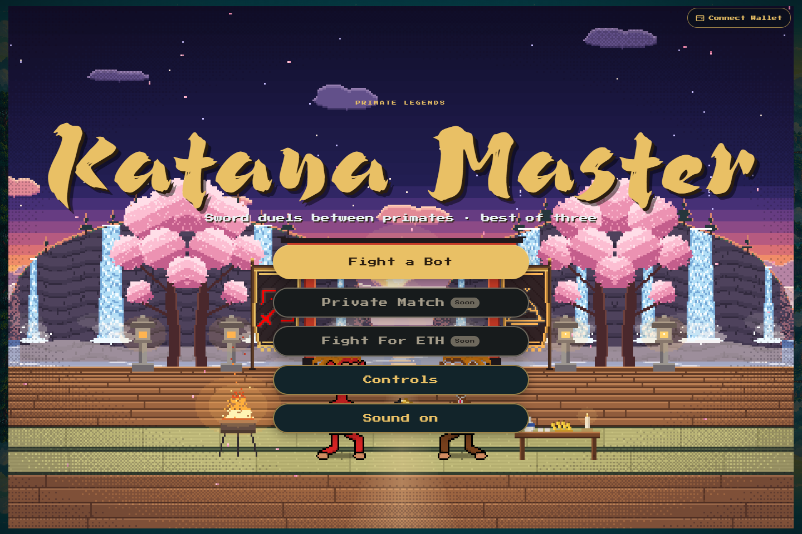
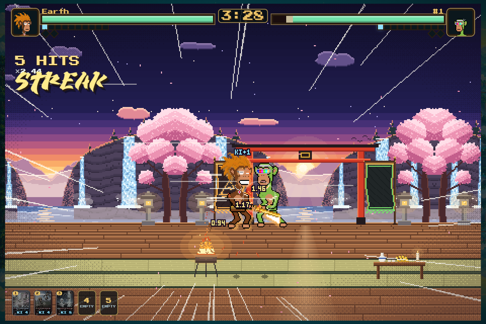
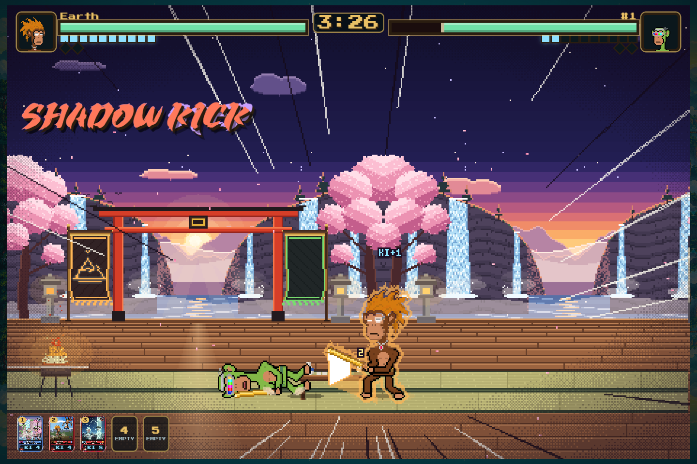
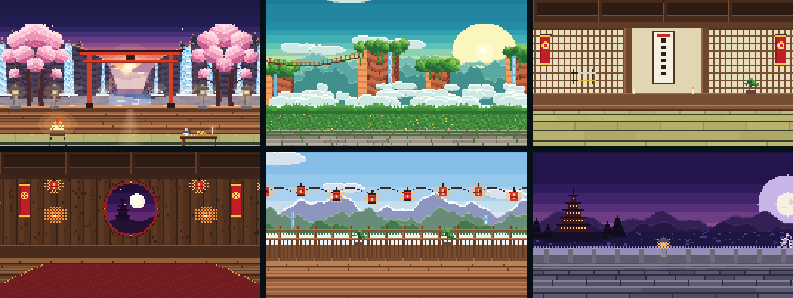
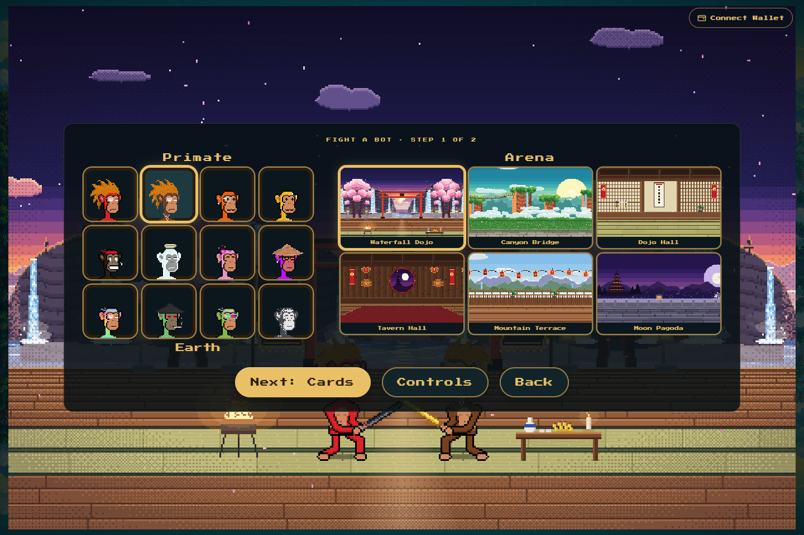
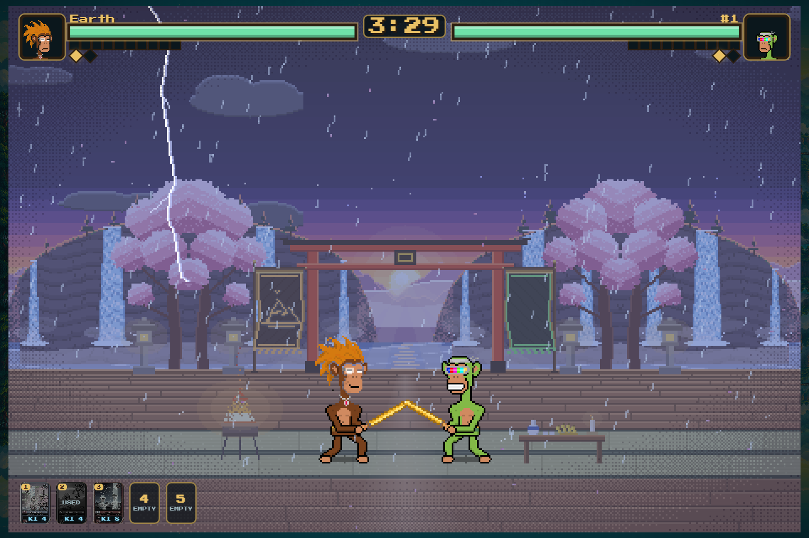

# Katana Master

Sword duels between primates, the next game of Primate Legends: 2D pixel-art fights, best of three, with your
clan's primate and its own blade, and the Katana Brawl cards as finishing moves. First up is **Fight a Bot**;
**Private Match** and **Fight For ETH** come next.

<p align="center">
  
</p>

## How a duel works

- **Best of three.** Rounds last up to 3:30; a K.O. ends a round early, otherwise the fighter with more HP takes
  it. At 1-1 the deciding round is fought in a storm.
- **50 HP, combos.** A cut deals 1; every further hit of an unbroken combo deals x1.25 more, up to the 5th hit.
  Blows from the air onto a rival below deal +20%.
- **Ki** fills from landing 2-hit combos, from damage taken (1 per 4 HP) and from blocking (1 per 3 blocks), and
  every gain is worth 1.3. A guard raised right before the blade lands is a **PERFECT** block and pays 1 Ki.
- **Movement.** Double-tap a side to dash, or back-flip away from the rival. Shift teleports in front of the
  rival for 1 Ki, up to 4 in a row, then a 10 s rest. D D A / A A D teleports to the rival's back.
- **Streak.** A rival left unguarded half a second into your combo can be jumped on for a diagonal beating of 5
  quick blows. Teleport behind it within a second and your next kick, the **Shadow Kick**, deals double and floors it.

<p align="center">
  
  
</p>

## Cards

Before the fight you pick up to **5 Katana Brawl cards** (keys 1 to 5). Each one works **once per match**, costs
Ki and casts instantly in any state except lying on the ground. Every cast is a 2-3 second move with its own
effect: beams, a frozen tomb, a stone wall, a tornado. **Last Breath** is never cast by hand: it fires on its own,
free, when you drop under 2 HP, and for 5 s nothing takes you below 1 HP. Hovering a card in the loadout explains
what it does.

## Arenas

Six arenas, each with its own sky, particles and fog: Waterfall Dojo, Canyon Bridge, Dojo Hall, Tavern Hall,
Mountain Terrace and Moon Pagoda.

<p align="center">
  
</p>

<p align="center">
  
  
</p>

## The bot

Three levels, picked under the cards:

| Level | How it fights |
| --- | --- |
| Easy | Slow, careless attacks and little guarding, but it never stands still. Brings 3 or 4 cards. |
| Normal | Fast bursts of 3-5 cuts, a solid guard, blades that clash. |
| Hard | The same attack as Normal; reads almost every swing, times PERFECT blocks, back-flips or teleports out of cuts, vanishes out of combos and plays its cards by the situation (finish, heal, shield, punish). |

## Fair play

A browser game can be edited by whoever runs it, so Katana Master is built in layers:

1. **In the browser.** The rules and move tables are frozen (a console script can't change damage or
   cooldowns), only trusted key and pointer events count, turbo repeats are dropped, and machine-like input
   (too many presses a second, or a metronome rhythm) is flagged on the result. Test hooks only exist on a
   developer's own machine. See [`input-guard.js`](../apps/katana-master/src/input-guard.js).
2. **The referee.** For duels that matter, the clients send their inputs, not their result. The referee replays
   both logs tick by tick with integer-only rules and decides the outcome. A tampered client can show what it
   likes on its own screen but can't change the replay. The JavaScript referee
   ([`duel.js`](../apps/katana-master/src/duel.js)) and the server one in Python
   ([`services/duel-referee`](../services/duel-referee/)) reach the same hash for the same log, and CI checks it
   on shared fixtures.
3. **On-chain.** [`DuelRecords`](../contracts/DuelRecords.sol) stores each result once, only with the referee's
   signature, with the replay hash so anyone holding the logs can check it, and keeps a win/loss/draw tally per
   player for rankings.

```js
import { replay, logFromTimelines, KEY } from './apps/katana-master/src/index.js';

const log = logFromTimelines(
  [{ at: 0, mask: KEY.RIGHT }, { at: 1500, mask: KEY.ATTACK }, { at: 1520, mask: 0 }],   // player 0
  [{ at: 0, mask: KEY.BLOCK }],                                                          // player 1
);
const { winner, rounds, hash } = replay({ log });
```

## Status

| Item | Status |
| --- | --- |
| Fight a Bot: 12 primates, 6 arenas, 15 cards, 3 bot levels | In development (not on the site yet) |
| Referee replay (JavaScript + Python) | Draft, tested |
| [`DuelRecords`](../contracts/DuelRecords.sol) | Draft, not audited, not deployed |
| Private Match (play a friend) | Planned |
| Fight For ETH | Planned |
